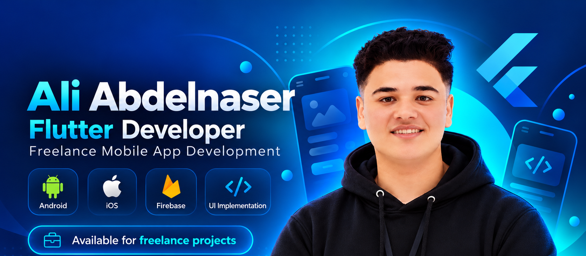

<!-- Ali Abdelnaser • Flutter-focused GitHub profile • Dark / Cyan / Electric Blue -->

  
    
  
    
  
<strong>Open to Flutter opportunities, freelance projects &amp; creative collaborations.</strong>

  
  
  

---

## 🌌 About Me

<table>
<tr>
<td valign="top" width="66%">

Hey, I'm <strong>Ali Abdelnaser</strong> — a Flutter developer who loves turning ideas into intuitive, reliable <strong>Android and iOS experiences</strong>.

I've spent around <strong>two years learning and building with Flutter</strong>, including over <strong>one year delivering real freelance client projects</strong>. I enjoy collaborating with development teams, refining user experiences, and solving the problems behind production apps.

What excites me most: <strong>Clean Architecture, reusable UI, API integrations, debugging, and thoughtful design</strong>. I'm always exploring new tools and finding simpler ways to build better software.

</td>
<td width="34%" align="center" valign="middle">

</td>
</tr>
</table>

  
  
  
  
  

---

## ⚡ My Development Toolbox

  
    
  
  
  
  
  
  

---

## 📲 Published on Google Play & App Store

  
  
   
  
  
   
  

---

## 🚀 Selected Projects

| Application | What I built | Links |
|:--|:--|:--|
| 🚌 **Amomy Bus** | Built a **three-app** Flutter transport ecosystem (Passenger, Admin, Staff) connecting booking, seat selection, QR boarding, wallet and operations. |    |
| 🧱 **Brixel** | Built API-connected Flutter workflows for construction procurement, including **BOQs, RFQs, supplier quotations and purchasing**. |   |
| 🥗 **Five2Ten** | Published a Flutter nutrition app combining **OCR, AI-assisted food-label analysis, Firebase and gamified daily tasks**. |  |
| ✉️ **Smart Mail** | Created email campaign workflows with **Flutter, SMTP, Firebase and Cloud Functions** for scheduled sending and tracking. | Private / client-focused work |
| 🎟️ **MIE App** | Built QR-based event attendance with **Supabase, Hive offline-first storage and synchronization**. | Project overview available on request |

Selected applications are linked to their public store listings. Some team and client code is not publicly shared.

---

## 📊 GitHub Insights

  
    
  
    
  

---

## 🐍 Contribution Snake

  <picture>
    <source media="(prefers-color-scheme: dark)" srcset="https://raw.githubusercontent.com/Ali-Abdelnaser/Ali-Abdelnaser/output/github-contribution-grid-snake-dark.svg" />
    
  </picture>

This contribution animation is generated automatically by GitHub Actions.

---

## 💬 Let's Connect

  <h3>Let's build something meaningful together.</h3>
  
  
  
    
  

